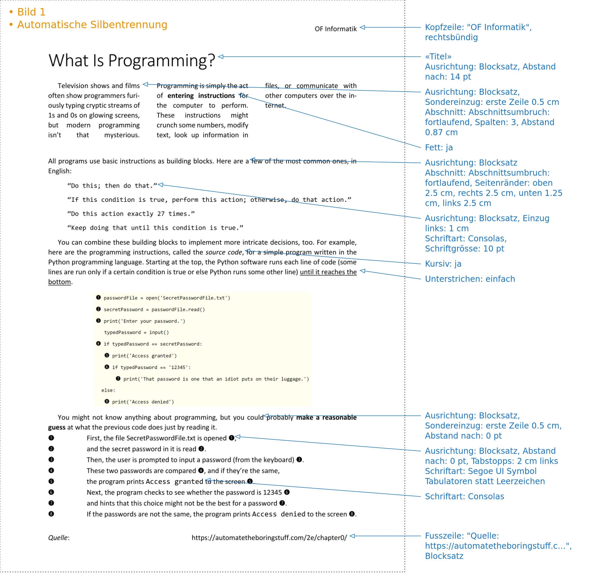

import Steps from '@tdev-components/Steps';
import CodeShowcase from '@tdev-components/CodeShowcase';
import DocxGrader from '@hfr/docx-grader/components/DocxGrader';
import spec from './assets/ex01-what-is-programming.docx-spec.yaml';

# docx-grader

:::warning[WIP 🚧]
Dieses Package ist neu ([#385](https://github.com/GBSL-Informatik/teaching-dev/issues/385)). Tabellen werden ins unformatierte Dokument übernommen, ihre Formatierung wird aber noch nicht überprüft.
:::

Schüler:innen erhalten ein unformatiertes Word-Dokument und formatieren es so wie ein Original der Lehrperson. Der docx-grader überprüft danach wie bei Unit-Tests, welche Formatierungen bereits stimmen.

<CodeShowcase lang="md" imports={[`import DocxGrader from '@hfr/docx-grader/components/DocxGrader';`, `import spec from './assets/ex01-what-is-programming.docx-spec.yaml';`]}>
<DocxGrader spec={spec} />
</CodeShowcase>

Zum Ausprobieren (die Beispieldateien stammen aus [#385](https://github.com/GBSL-Informatik/teaching-dev/issues/385)): Lade das [unformatierte Dokument](./assets/ex01-what-is-programming-raw.docx) oder das [Original](./assets/ex01-what-is-programming.docx) herunter und ziehe es auf die Komponente.

Das Dokument wird nur im Browser überprüft: Es wird nicht hochgeladen und das Resultat wird nicht gespeichert.

`spec`
: Die docx-spec, als YAML-Datei importiert (`unknown`, wird beim Rendern überprüft). Fehler in der Datei werden oberhalb der Komponente angezeigt; fehlerhafte Checks werden übersprungen.
`className`
: Optionale CSS-Klasse.

## Spezifikation und unformatiertes Dokument erstellen

<Steps>

1. Formatiere das Original in Word fertig: Formatvorlagen, Absatz- und Zeichenformate, Abschnitte, Kopf- und Fusszeilen, Bilder mit Beschriftungen und Verzeichnisse.
2. Erstelle daraus die Spezifikation und das unformatierte Dokument:

   ```bash
   yarn workspace @hfr/docx-grader create-spec docs/word/original.docx
   ```

   Relative Pfade gelten ab dem Hauptordner des Repositorys.

3. Wähle in der Liste die Formatierungen ab, die nicht überprüft werden sollen, und bestätige mit [[Enter]].
4. Ergänze in der erzeugten Datei __docs/word/original.docx-spec.yaml__ bei Bedarf Hinweise und Links zur Dokumentation.
5. Gib den Schüler:innen __docs/word/original-raw.docx__ ab, zusammen mit einem (annotierten) Bild des Originals, und binde die Spezifikation mit `<DocxGrader>` ein.

</Steps>

`--out <datei.docx-spec.yaml>`
: Pfad der Spezifikation.
: Standard: neben dem Original, mit der Endung `.docx-spec.yaml`.
`--all`
: Übernimmt alle Formatierungen ohne Auswahlliste.

Wird das CLI erneut ausgeführt, sind die zuvor übernommenen Formatierungen vorausgewählt, und Hinweise sowie Links bleiben erhalten. Das unformatierte Dokument wird jedes Mal neu geschrieben.

Das unformatierte Dokument enthält nur noch:

- den Text jedes Absatzes, mit Zeilenumbrüchen, in der Formatvorlage «Standard» eines leeren Dokuments; Tabulatoren werden durch Leerzeichen ersetzt,
- alle Bilder, mit Text in Zeile und 5 cm breit,
- Tabellen ohne Formatvorlage, Rahmen und Breiten,
- von Bildunterschriften nur die Beschreibung, ohne «Abbildung 1:».

Verzeichnisse, Kopf- und Fusszeilen, Abschnitte, Nummerierungen, leere Absätze und Kommentare entfallen.

## Annotierte Bilder (Prototyp)

Für die Schüler:innen lässt sich pro Seite des Originals ein Bild erzeugen, auf dem die überprüften Formatierungen beschriftet sind:

<Steps>

1. Erstelle zuerst die Spezifikation (siehe oben).
2. Exportiere das Original in Word als PDF (__Datei › Speichern unter › PDF__), z.B. als __docs/word/original.pdf__.
3. Erzeuge die Bilder:

   ```bash
   yarn workspace @hfr/docx-grader annotate docs/word/original.docx --pdf docs/word/original.pdf
   ```

4. Binde die Bilder ein, z.B. ``, und passe die Beschriftungen bei Bedarf im Bild-Editor an.

</Steps>

Für das Beispiel oben entsteht aus dem [Original](./assets/ex01-what-is-programming.docx) und seinem [PDF-Export](./assets/ex01-what-is-programming.pdf):

```bash
yarn workspace @hfr/docx-grader annotate packages/hfr/docx-grader/assets/ex01-what-is-programming.docx --pdf packages/hfr/docx-grader/assets/ex01-what-is-programming.pdf
```



Neben jedem Bild __original-annotated-1.webp__ entsteht __original-annotated-1.webp.excalidraw__: Die Seite ist darin das Hintergrundbild (`TDEV-BACKGROUND--FILE`), die Beschriftungen und Pfeile sind gewöhnliche Excalidraw-Elemente. Im [Bild-Editor](/docs/gallery/tools/image-markup) lassen sie sich verschieben, ändern oder löschen; beim Speichern wird das Bild neu exportiert.

Die Bilder sind standardmässig WebP (`--format png` für PNG). Das erzeugte Bild ist eine Vorschau; sobald die Szene im Editor gespeichert wird, ersetzt sie der Export von Excalidraw. Das CLI braucht die Pakete `canvas` und `sharp`, die als optionale Abhängigkeiten installiert werden.

Die Beschriftungen stehen rechts neben der Seite, mit einem Pfeil zur ersten Stelle pro Seite, an der ein Check gilt. Mehrere Checks für dieselbe Stelle teilen sich eine Beschriftung. Was im PDF keine Stelle hat (z.B. Bilder ohne Beschriftung, Verzeichnisse oder die Silbentrennung), steht als orange Liste oben links auf der ersten Seite. Text in Kopf- und Fusszeilen (nach den Seitenrändern des ersten Abschnitts) wird dabei nur für die Checks der Kopf- und Fusszeilen gesucht.

## Was überprüft wird

Überprüft wird nur, was vom leeren Word-Dokument (Normal.dotm) abweicht.

Absatz- und Zeichenformate müssen so entstehen wie im Original: Kommt z.B. der Blocksatz im Original aus der Formatvorlage «Standard», muss er auch bei den Schüler:innen aus der Formatvorlage kommen (`source: style`); direkt formatierter Blocksatz wird dann als Fehler gemeldet. Was im Original direkt formatiert ist, darf auf beide Arten entstehen. Mit `defaultSource: style` verlangt die Spezifikation für alle Formate Formatvorlagen; einzelne Checks lassen sich mit `source: any` davon ausnehmen.

Automatisch erzeugte Inhalte müssen automatisch erzeugt sein: Nummerierungen von Überschriften und Listen, Seitenzahlen, Beschriftungen und Verzeichnisse. Eine von Hand eingetippte Nummer wie «1.1 » wird erkannt und gemeldet.

Formatvorlagen
: Welche Formatvorlage ein Absatz verwendet.
Absatzformat
: Ausrichtung, Einzüge, Abstände, Zeilenabstand, Tabstopps und Umbruchsteuerung.
Tabulatoren
: Tabulatoren an denselben Stellen wie im Original. Leerzeichen gelten nicht als Tabulator.
Zeichenformat
: Schriftart, -grösse, -farbe, fett, kursiv, unterstrichen, durchgestrichen, Hervorhebung, Grossbuchstaben, Kapitälchen, hoch- und tiefgestellt.
Aufzählungen und Nummerierungen
: Art und Ebene der Aufzählung, bei Nummerierungen auch das Muster (z.B. `1.1`).
Abschnitte und Seitenlayout
: Abschnittsumbruch, Ausrichtung, Seitenränder, Spalten, Seitenzahlenformat und -beginn, erste Seite anders.
Kopf- und Fusszeilen
: Text, Seitenzahl und Ausrichtung.
Bilder und Beschriftungen
: Breite (±0.3 cm), Layout und Textumbruch. Die Beschriftung muss direkt vor oder nach dem Bild stehen oder mit ihm gruppiert sein; die genaue Position spielt keine Rolle.
Verzeichnisse
: Inhalts-, Abbildungs- und Literaturverzeichnis.
Dokument
: Automatische Silbentrennung.

Die Formatierungen werden über den Text der Absätze gefunden. Deshalb dürfen Schüler:innen den Text nicht verändern. Bilder werden über ihre Reihenfolge gefunden.

## Aufbau der docx-spec

```yaml
version: 1
source: original.docx
checks:
  - id: paragraphStyle-formatvorlage-ueberschrift-1
    kind: paragraphStyle
    title: Formatvorlage «Überschrift 1»
    anchors:
      - text: Zielsetzung
      - text: Über die Autoren
    expect:
      style: heading 1
    hint: Verwende die Formatvorlage «Überschrift 1», damit die Überschrift im Inhaltsverzeichnis erscheint.
    docs: /word/formatvorlagen
```

`id`
: Eindeutige Kennung, abgeleitet aus Art und Titel. Sie bleibt gleich, solange das Original gleich formatiert ist.
`kind`, `anchors`, `expect`
: Art, Fundstellen und erwartete Werte. Werden vom CLI erzeugt; Werte in `expect` dürfen angepasst werden.
`title`
: Wird den Schüler:innen angezeigt.
`hint`
: Optionaler Hinweis, der bei einem Fehler angezeigt wird.
`docs`
: Optionaler Link zu einer Seite der Dokumentation.
`source`
: Nur bei Absatz- und Zeichenformaten: `style` verlangt, dass die erwarteten Werte aus einer Formatvorlage stammen, `any` erlaubt auch direkte Formatierung.
: Standard: `defaultSource`. Das CLI setzt `style`, wo das Original die Werte aus der Formatvorlage hat.
`defaultSource`
: Optional, auf oberster Ebene: `source` für alle Checks ohne eigenes `source`.
: Standard: `any`.
`equivalentCharacters`
: Optional, auf oberster Ebene: Gruppen von Zeichen, die beim Textvergleich als gleich gelten.
: Standard: `[['-', '–', '—', '‑'], ['"', '“', '”', '„', '«', '»'], ["'", '‘', '’', '‚', '‹', '›']]`. Leerräume werden immer zu einem Leerzeichen zusammengefasst; Tabulatoren überprüft die eigene Art `tabs`.
